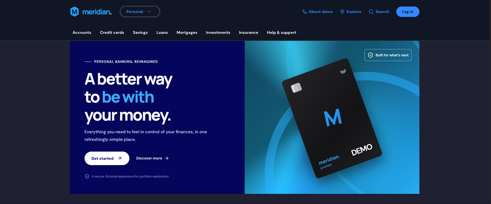

# Meridian — Digital Banking Portfolio Application



A **fictional, full-stack online banking simulation** built with **React, TypeScript, Java Spring Boot and PostgreSQL**. Meridian demonstrates secure authentication, user-scoped account data, accurate financial arithmetic and idempotent, transactional fund transfers behind a responsive navy-and-blue interface.

> **Important:** Meridian is not a real bank and is not affiliated with any financial institution. All balances, accounts and transfers are fictional. Do not enter real passwords, customer data or payment details. This is a portfolio project, not production financial software.

Related documents: [Design.md](Design.md) (UI/UX and architecture) · [RULE.md](RULE.md) (development standards) · [LICENSE.md](LICENSE.md) (MIT)

---

## Table of contents

1. [Overview and objectives](#overview-and-objectives)
2. [Features](#features)
3. [Technology stack](#technology-stack)
4. [Prerequisites (macOS + Homebrew)](#prerequisites-macos--homebrew)
5. [PostgreSQL setup (no Docker)](#postgresql-setup-no-docker)
6. [Installation and running](#installation-and-running)
7. [Environment variables and configuration](#environment-variables-and-configuration)
8. [Pages and routes](#pages-and-routes)
9. [REST API](#rest-api)
10. [Authentication and authorization](#authentication-and-authorization)
11. [Database schema](#database-schema)
12. [Testing](#testing)
13. [Troubleshooting](#troubleshooting)
14. [Continuous integration (Jenkins)](#continuous-integration-jenkins)
15. [Screenshots](#screenshots)
16. [Project structure](#project-structure)
17. [Roadmap](#roadmap)
18. [License](#license)

---

## Overview and objectives

Meridian is a portfolio project that shows how a small digital-banking product fits together end to end:

- A **React + TypeScript** single-page app (Vite) with a public homepage, authentication and a signed-in dashboard.
- A **Spring Boot 3 / Java 21** REST API secured with stateless JWTs.
- A **PostgreSQL** database managed through **Flyway** migrations.

Objectives:

- Keep money correct: `BigDecimal` and `NUMERIC(19,2)` on the server, whole-pence arithmetic in the browser.
- Keep data private: every account query is scoped to the authenticated user and ownership is enforced server-side.
- Keep transfers safe: one database transaction, pessimistic locks, balance checks and idempotency keys.
- Present a polished, accessible, responsive interface with original Meridian branding.

## Features

| Area | Status |
| --- | --- |
| Public homepage | Implemented — hero, products, mobile showcase, footer |
| Registration and login | Implemented — BCrypt (cost 12) hashing, 2-hour signed JWTs |
| Dashboard | Implemented — "Your total balance", account cards, quick actions, six-month money in/out chart, recent activity |
| Total balance | Implemented — calculated dynamically from the accounts returned by `GET /api/accounts`; never hardcoded |
| Accounts | Implemented — current and savings accounts, sort code, account ending, searchable and filterable activity |
| Transfers | Implemented — between two of the user's own accounts, insufficient-funds checks, £50,000 limit, ledger entries, idempotency via `requestId`; dashboard balances refresh after success |
| Statements | Implemented — CSV export per account and date range (spreadsheet-formula-safe) |
| Settings | Implemented — profile and security overview |
| UI states | Loading, empty (no accounts) and API-error states on the dashboard; success and error states on transfers |
| Browser-only demo mode | Implemented — localStorage-backed fictional data, no backend required |
| Automated tests | 45 backend unit + 39 PostgreSQL integration tests, 94 frontend component/logic tests, 5 browser-demo tests, with coverage gates |
| Continuous integration | Jenkins declarative pipeline (`Jenkinsfile`): test, coverage and build verification on macOS, no Docker. Tested locally; not yet run on a live Jenkins server |
| Docker Compose | Optional — provided, not required |

Not implemented (see [Roadmap](#roadmap)): external payees, MFA, refresh tokens, rate limiting, audit logging, PDF statements, browser end-to-end tests and automated deployment.

## Technology stack

| Layer | Technology |
| --- | --- |
| Frontend | React 19, TypeScript 5 (strict), Vite 6, React Router 7, lucide-react |
| Backend | Java 21, Spring Boot 3.4.5 (Web, Security, Data JPA, Validation, Actuator), jjwt 0.12.6 |
| Database | PostgreSQL, Flyway migrations |
| Testing | JUnit 5, Mockito, Spring Boot Test, JaCoCo (backend); Vitest, React Testing Library, axe-core (frontend) |
| Build | Maven (backend), npm (frontend) |
| CI | Jenkins (Declarative Pipeline), GitHub |
| Optional | Docker and Docker Compose |

---

## Prerequisites (macOS + Homebrew)

```bash
# Install Homebrew first if needed: https://brew.sh
brew install openjdk@21 maven node postgresql@15

# Make Homebrew's JDK discoverable (follow the caveats brew prints; typically:)
sudo ln -sfn /opt/homebrew/opt/openjdk@21/libexec/openjdk.jdk /Library/Java/JavaVirtualMachines/openjdk-21.jdk

java -version     # 21+
mvn -version
node -v           # 22+ recommended
psql --version
```

Docker is **not** required.

## PostgreSQL setup (no Docker)

The project is configured for a Homebrew PostgreSQL server on **`localhost:5432`**, database **`meridian`**, role **`meridian`** (defaults live in `backend/src/main/resources/application.yml`).

```bash
# 1. Start PostgreSQL (use the formula you installed, e.g. postgresql@15)
brew services start postgresql@15
pg_isready -h localhost -p 5432        # expect: accepting connections

# 2. Create the role and database (first time only)
psql postgres <<'SQL'
CREATE ROLE meridian WITH LOGIN PASSWORD 'meridian_dev_only';
CREATE DATABASE meridian OWNER meridian;
SQL

# 3. Verify
psql -h localhost -U meridian -d meridian -c '\conninfo'
```

`meridian_dev_only` is a **local development password only**. Use a different secret anywhere else.

You do **not** create tables by hand: Flyway runs `backend/src/main/resources/db/migration/V1__init.sql` when the API starts. Existing databases, accounts, balances and transactions are never dropped or rewritten by startup (`ddl-auto: validate`).

## Installation and running

The backend and frontend run independently. Start PostgreSQL first, then the API, then the UI.

### Backend (Spring Boot + Maven)

```bash
cd backend
mvn spring-boot:run
```

- API: <http://localhost:8080>
- Health: <http://localhost:8080/actuator/health>
- Build a jar instead: `mvn clean package` then `java -jar target/banking-api-1.0.0.jar`

On first start with `SEED_DEMO=true` (the default) a demo user is created **only if it does not already exist**:

| Email | Password | Accounts |
| --- | --- | --- |
| `demo@meridian.test` | `Demo1234!` | Everyday account £1,065.45 · Rainy day savings £5,557.24 — **total £6,622.69** |

> The seeder never edits existing rows. A database seeded by an earlier version keeps its earlier balances. To re-seed from scratch, drop and recreate the local `meridian` database (this deletes local data — do not do this to data you want to keep).

New users who register receive two fictional accounts with opening deposits (£4,250.00 and £1,800.00).

### Frontend (React + Vite)

```bash
cd frontend
npm install
npm run dev
```

Open <http://localhost:5173>. Vite proxies `/api` to `http://localhost:8080`, so no CORS setup is needed in development.

Production build: `npm run build` (type-checks with `tsc -b`, then `vite build`), preview with `npm run preview`.

### Frontend only (browser demo, no backend or database)

```bash
cd frontend
npm install
npm run demo
```

Uses `VITE_DEMO_MODE=true` (`frontend/.env.demo`). Data lives in browser localStorage under `meridian_demo_bank_state_v2`; clear that key to reset. Same demo credentials as above. Never type a real password in demo mode.

### Optional: Docker Compose

```bash
cp .env.example .env     # then change DB_PASSWORD and JWT_SECRET
docker compose up --build
```

Web: <http://localhost:3000> · API: <http://localhost:8080>. Remove local data with `docker compose down -v`.

## Environment variables and configuration

Never commit `.env` files (they are in `.gitignore`). Copy `.env.example` as a starting point.

### Backend

| Variable | Default | Purpose |
| --- | --- | --- |
| `PORT` | `8080` | HTTP port |
| `DB_URL` | `jdbc:postgresql://localhost:5432/meridian` | JDBC URL |
| `DB_USER` | `meridian` | Database role |
| `DB_PASSWORD` | `meridian_dev_only` | Database password (**change outside local dev**) |
| `JWT_SECRET` | local development value | HMAC signing key, **at least 32 bytes**; use a long random value elsewhere |
| `CORS_ORIGIN` | `http://localhost:5173` | Comma-separated allowed browser origins |
| `SEED_DEMO` | `true` | Create the demo user if missing; set `false` for any shared environment |

Example with overrides:

```bash
export DB_PASSWORD='your-local-password'
export JWT_SECRET="$(openssl rand -base64 48)"
cd backend && mvn spring-boot:run
```

### Frontend

| Variable | Default | Purpose |
| --- | --- | --- |
| `VITE_DEMO_MODE` | `false` | `true` runs entirely in the browser against fictional localStorage data |

## Pages and routes

| URL | Description |
| --- | --- |
| `/` | Public homepage |
| `/login`, `/register` | Authentication |
| `/app` | Dashboard: total balance, accounts, quick actions, chart, recent activity |
| `/app/accounts` | Account details and transaction history (`?account=<id>` preselects an account) |
| `/app/transfer` | Move money between your own accounts |
| `/app/statements` | CSV statement export |
| `/app/settings` | Profile and security overview |

`/app/**` routes require a signed-in session; unknown URLs redirect to `/`.

## REST API

Base path `/api`. Every endpoint except `/api/auth/**` and `/actuator/health` requires `Authorization: Bearer <token>`. Errors are returned as `{ "error": "message" }`.

| Method | Endpoint | Description |
| --- | --- | --- |
| `POST` | `/api/auth/register` | Create a user; returns token and user |
| `POST` | `/api/auth/login` | Authenticate; returns token and user |
| `GET` | `/api/me` | Authenticated user's profile |
| `GET` | `/api/accounts` | Accounts owned by the authenticated user |
| `GET` | `/api/accounts/{id}/transactions?limit=50` | Ledger for an owned account (limit clamped to 1–200) |
| `POST` | `/api/transfers` | Transfer between two owned accounts |
| `GET` | `/api/accounts/{id}/statement?from=YYYY-MM-DD&to=YYYY-MM-DD` | CSV statement (last five years) |

### Examples

```bash
# Log in and capture the token
TOKEN=$(curl -s -X POST http://localhost:8080/api/auth/login \
  -H 'Content-Type: application/json' \
  -d '{"email":"demo@meridian.test","password":"Demo1234!"}' | python3 -c 'import sys,json; print(json.load(sys.stdin)["token"])')

# List accounts
curl -s http://localhost:8080/api/accounts -H "Authorization: Bearer $TOKEN"
```

```json
[
  { "id": "…", "name": "Everyday account",  "accountType": "CURRENT", "accountNumber": "48271936", "sortCode": "20-42-66", "balance": 1065.45 },
  { "id": "…", "name": "Rainy day savings", "accountType": "SAVINGS", "accountNumber": "68104472", "sortCode": "20-42-66", "balance": 5557.24 }
]
```

```bash
# Transfer £25.50 (use real UUIDs from /api/accounts; generate a fresh requestId per transfer)
curl -s -X POST http://localhost:8080/api/transfers \
  -H "Authorization: Bearer $TOKEN" -H 'Content-Type: application/json' \
  -d '{
    "requestId": "20f2bdd0-f36b-4bdb-a72c-c7044c3a105d",
    "fromAccountId": "<everyday account UUID>",
    "toAccountId": "<savings account UUID>",
    "amount": "25.50",
    "reference": "Monthly savings"
  }'
```

Transfer rules: amount ≥ 0.01 with at most two decimals, maximum £50,000, accounts must differ and both belong to the caller, and the source must have sufficient funds. Re-sending the same `requestId` with identical details returns the original transfer without moving money again; reusing it with different details returns `409`.

The dashboard total is **not** an API field. The frontend sums the `balance` of every account returned by `GET /api/accounts` (in whole pence, avoiding floating-point drift) and re-fetches after every successful transfer.

## Authentication and authorization

1. `POST /api/auth/login` verifies the password with BCrypt (cost 12) and returns a JWT whose subject is the user's UUID, signed with HMAC (`JWT_SECRET`), valid for two hours.
2. `JwtFilter` reads the `Bearer` token on each request, verifies it, confirms the user still exists and places the user ID in the Spring `SecurityContext`. The API is stateless (no server session).
3. `SecurityConfig` permits `/api/auth/**` and `/actuator/health`; everything else requires authentication. CSRF protection is disabled because authentication uses an `Authorization` header rather than cookies.
4. **Authorization is ownership-based.** Services never trust an account ID from the client alone: lookups use `findByIdAndUserId`, and transfers verify both accounts' `userId` after locking them. Other users' accounts return `404`.
5. The browser stores the token in `sessionStorage`; a `401`/`403` response clears it and returns to `/login`. (HttpOnly cookies are on the roadmap.)

## Database schema

```text
users         (id PK, full_name, email UNIQUE, password_hash, created_at)
accounts      (id PK, user_id FK→users, account_number UNIQUE, sort_code, name,
               account_type, balance NUMERIC(19,2) CHECK ≥ 0, version, created_at)
transfers     (id PK, user_id FK, request_id, from_account_id FK, to_account_id FK,
               amount NUMERIC(19,2) CHECK > 0, reference, created_at,
               UNIQUE (user_id, request_id), CHECK from ≠ to)
transactions  (id PK, account_id FK, transfer_id FK?, kind CREDIT|DEBIT, description,
               amount NUMERIC(19,2) CHECK > 0, balance_after, created_at)
```

Indexes: `accounts(user_id)`, `transactions(account_id, created_at DESC)`. Migration history is tracked in `flyway_schema_history`. Schema changes must be new versioned migrations; never edit an applied one.

## Testing

```bash
# Backend unit tests (JUnit 5 + Mockito, no database)
cd backend && mvn test

# Backend unit + integration tests with coverage (needs the isolated PostgreSQL test database, see below)
cd backend
export TEST_DB_USER=meridian_test TEST_DB_PASSWORD='the-password-you-chose'
mvn verify

# Frontend: Vitest + React Testing Library (add :coverage for thresholds and HTML report)
cd frontend && npm test
cd frontend && npm run test:coverage

# Frontend: type-check, production build and the original browser-demo logic tests
cd frontend && npm run typecheck && npm run build && npm run test:demo
```

**Integration tests never use the development database.** They run against a separate database `meridian_test` with its own least-privilege role. Create it once (create-only; it never drops or alters anything):

```bash
TEST_DB_PASSWORD='choose-a-strong-password' scripts/ci/create-test-db.sh
```

The `test` Spring profile points Flyway and JPA at that database, disables demo seeding, and the tests refuse to start if the database name does not end in `_test`. The password comes only from `TEST_DB_PASSWORD`; it is never committed.

| Suite | Tests | Covers |
| --- | --- | --- |
| Backend unit (`*Test`) | 45 | Transfer rules, `BigDecimal` totals, idempotency, ownership, statements, JWT, auth controller, JWT filter, DTO validation |
| Backend integration (`*IT`) | 39 | Registration/login/JWT over HTTP, access control between customers, transfers, rollback, concurrent duplicate requests, DB constraints, Flyway |
| Frontend (Vitest) | 94 | Homepage, auth forms, dashboard (loading/error/empty/success), account cards, dynamic totals, history, transfer validation and results, responsive nav, API client, axe accessibility checks |
| Frontend demo (`test:demo`) | 5 | Browser-only demo data layer |

Coverage gates: **80% line coverage** of the `service` and `auth` backend packages (JaCoCo, fails `mvn verify`) and of the frontend `format`, `api`, `AuthContext` and `BankContext` modules (Vitest thresholds). Last measured: those backend classes 100%; those frontend modules 100% of lines; frontend overall 71.7% lines (reported, not gated). Reports: `backend/target/site/jacoco/index.html`, `frontend/coverage/index.html`.

Not covered yet: browser end-to-end tests (e.g. Playwright), contrast verification, and the statement/settings pages in depth. See the roadmap.

## Troubleshooting

| Symptom | Fix |
| --- | --- |
| `Connection refused` to `localhost:5432` | Start PostgreSQL: `brew services start postgresql@15`; check `pg_isready -h localhost -p 5432`. |
| `password authentication failed for user "meridian"` | Role password differs from `DB_PASSWORD`. Run `ALTER ROLE meridian PASSWORD '…';` or export the matching `DB_PASSWORD`. |
| `database "meridian" does not exist` | `createdb -O meridian meridian` (see setup above). |
| `Port 8080 already in use` | `lsof -i :8080`, stop the process, or run with `PORT=8081` (and update `vite.config.ts` proxy target). |
| `JWT_SECRET must be at least 32 bytes` | Provide a longer secret, e.g. `export JWT_SECRET="$(openssl rand -base64 48)"`. |
| Flyway validation / schema errors | Do not edit applied migrations. Add a new `V2__…sql`. For a disposable local DB only, drop and recreate it. |
| `Unsupported class file major version` / compile errors | Ensure `java -version` reports 21+ and `JAVA_HOME` points to it. |
| UI shows "We couldn't load your banking data" | The API is not running or not reachable at `localhost:8080`; check backend logs and `/actuator/health`, then use **Try again**. |
| Logged out unexpectedly | Tokens last two hours, and the API rejects tokens signed with a previous `JWT_SECRET`. Log in again. |
| Balances differ from this README | The seeder only creates the demo user once; an older database keeps its earlier balances. |
| A CI/integration test says `TEST_DB_PASSWORD is not set` | Export `TEST_DB_USER` and `TEST_DB_PASSWORD` for the `meridian_test` role (see [Testing](#testing)). |
| Demo mode shows old numbers | Clear `meridian_demo_bank_state_v2` (and older `_v1`) from localStorage. |

## Continuous integration (Jenkins)

A declarative [`Jenkinsfile`](Jenkinsfile) builds and tests every push to `master` and every pull request. It **only tests and builds**: nothing is deployed, and Docker is not needed. Full details: **[docs/JENKINS.md](docs/JENKINS.md)**.

### Pipeline stages

Checkout → Environment Validation → Install Dependencies → Backend Unit Tests → Backend Integration Tests (PostgreSQL) → Frontend Tests → TypeScript Validation → Frontend Build → Backend Build → Publish Reports. A failing required stage fails the build, and test reports are still published.

### Set up Jenkins on macOS

```bash
brew install jenkins-lts                 # plus openjdk@21 maven node postgresql@15 from the prerequisites
jenkins-lts --httpPort=8081              # 8080 is used by the Spring Boot API
```

Open <http://localhost:8081>, unlock with `~/.jenkins/secrets/initialAdminPassword`, install the suggested plugins and add: **GitHub Branch Source**, **Credentials Binding**, **JUnit**, **Timestamper**, and (optional) **Coverage**.

1. **Create the isolated test database once** (create-only, never drops anything, never touches `meridian`):

   ```bash
   TEST_DB_PASSWORD='choose-a-strong-password' scripts/ci/create-test-db.sh
   ```

2. **Add Jenkins credentials** (Manage Jenkins → Credentials):
   - `meridian-test-db`: *Username with password*, user `meridian_test` and the password from step 1.
   - A GitHub username + personal access token (or GitHub App) for scanning the repository and posting commit statuses.

   No JWT secret is needed in Jenkins: tests generate a random key per run. Never commit these values.

3. **Create a Multibranch Pipeline** job pointing at `https://github.com/domwokorach/Meridian-Digital-Banking`, with *Discover branches* (exclude branches that are also PRs), *Discover pull requests from origin* (merge with target) and the name filter `master|PR-.*`.

4. **GitHub webhook:** add `https://<your-jenkins>/github-webhook/` (events: pushes and pull requests). A Jenkins on `localhost` needs a tunnel such as `smee.io`, `ngrok` or `cloudflared`; otherwise enable the 5-minute periodic scan.

### Run a build manually

- In Jenkins: open the job → **Build with Parameters**.
- Without Jenkins, with the same commands in the same order:

  ```bash
  export TEST_DB_USER=meridian_test TEST_DB_PASSWORD='the-password-you-chose'
  scripts/ci/run-local.sh
  ```

### Understanding the results

- **Test Result** on a build lists every JUnit result (backend unit, backend integration, frontend). Open a failure for its stack trace.
- **Coverage** is gated at **80% line coverage** for the critical backend logic (`service` and `auth` packages, JaCoCo) and for the frontend money/API/auth-state modules (Vitest). Overall frontend coverage (about 72% lines at last measurement) is reported but not gated.
- **Artifacts:** `ci-reports/backend/jacoco/index.html`, `ci-reports/frontend/coverage/index.html`, JUnit XML, the backend JAR and `frontend/dist`.

### Troubleshooting failed pipelines

| Symptom | Fix |
| --- | --- |
| `Java 21 is required` | Set the `JAVA_HOME_21` parameter to the Homebrew `openjdk@21` path. |
| `psql not found` | Set `PG_BIN` to your PostgreSQL `bin` directory (`brew --prefix postgresql@15`). |
| `Cannot log in to meridian_test` | Run `scripts/ci/create-test-db.sh` and make the `meridian-test-db` credential match its password. |
| `Refusing to run integration tests` | The test database name must end in `_test`; the development database is never used by CI. |
| `npm ci` fails | Lockfile out of sync: run `npm install` in `frontend/` and commit `package-lock.json`. |
| Coverage threshold or JaCoCo rule violated | Add tests; do not lower the thresholds. |
| PR builds do not start | The webhook cannot reach Jenkins; use a tunnel or wait for the periodic scan. |

More in [docs/JENKINS.md](docs/JENKINS.md#8-troubleshooting).

> **Status:** every pipeline command was run and passed locally (`scripts/ci/run-local.sh`), including deliberate-failure checks. The Jenkinsfile has not yet been run on a live Jenkins server, and the GitHub webhook and commit-status integration are untested.

## Screenshots

The repository does not currently include binary screenshots. Static, runnable visual references that use the application's stylesheet are in [`previews/`](previews/):

- `previews/home.html` — homepage
- `previews/dashboard.html` — dashboard

## Project structure

```text
meridian-banking/
├── README.md  Design.md  RULE.md  LICENSE.md
├── Jenkinsfile                 # CI pipeline (test + build only)
├── docs/JENKINS.md             # detailed Jenkins setup and troubleshooting
├── scripts/ci/                 # create-test-db.sh, validate-environment.sh, run-local.sh
├── docker-compose.yml          # optional
├── .env.example  .gitignore
├── backend/
│   ├── pom.xml  Dockerfile
│   └── src/
│       ├── main/java/com/meridian/banking/
│       │   ├── api/            # controllers, DTO records, error handling
│       │   ├── auth/           # JwtService, JwtFilter
│       │   ├── config/         # SecurityConfig, DemoSeeder
│       │   ├── domain/         # JPA entities
│       │   ├── repo/           # Spring Data repositories
│       │   └── service/        # BankingService (business rules)
│       ├── main/resources/     # application.yml, db/migration/V1__init.sql
│       ├── test/java/…         # unit tests (*Test) and PostgreSQL integration tests (*IT, in integration/)
│       └── test/resources/     # application-test.yml (isolated test profile)
├── frontend/
│   ├── package.json  vite.config.ts  .env.example  .env.demo
│   ├── scripts/demo.test.mjs   # node:test browser-demo suite
│   ├── tests/                  # Vitest + React Testing Library suites, fixtures, setup
│   └── src/
│       ├── components/         # AccountCard, AppLayout, TransactionList, Brand, MarketingHeader
│       ├── context/            # AuthContext, BankContext
│       ├── lib/                # api.ts, demo.ts, format.ts, types.ts
│       └── pages/              # Landing, Auth, Dashboard, Accounts, Transfer, Statements, Settings
└── previews/                   # static visual references
```

## Roadmap

Planned, **not yet implemented**:

1. **Security:** HttpOnly cookie sessions, CSRF strategy, login throttling, MFA, audit log, secret rotation.
2. **Banking workflows:** external payees with confirmation, payment lifecycle, categorisation, notifications.
3. **Ledger:** double-entry ledger, reconciliation, fraud checks.
4. **Quality:** Playwright end-to-end tests, API contract tests, higher frontend coverage, verifying the Jenkins pipeline on a live server (webhook and commit statuses), CD, load testing.
5. **Product:** PDF statements, localisation, account preferences, broader accessibility audit.


